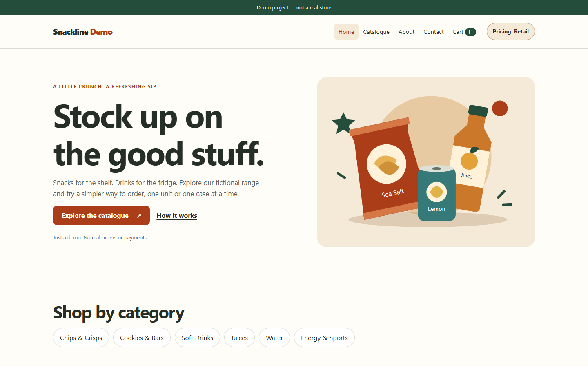
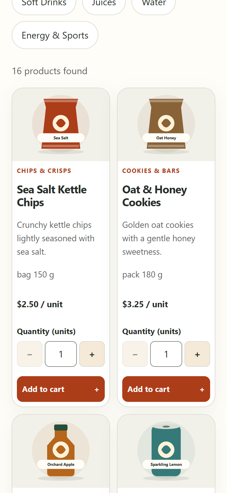
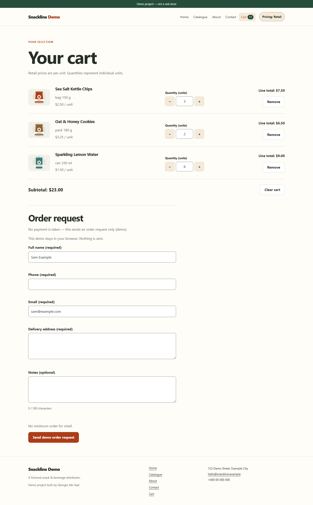

# Snackline Demo — online ordering site

> **Demo project — not a real store.** Snackline is a fictional snack & beverage distributor. No real orders or payments are processed.

**Live demo:** https://georgio-aa.github.io/demo-ordering-site/

A mobile-friendly catalogue and ordering website of the kind small distributors and shops need: browse products, build a cart, switch between retail and wholesale pricing, and send an order request.



| Mobile catalogue | Cart & order request |
| --- | --- |
|  |  |

## Features

- **Home page**: hero, intro, featured products, shop-by-category links, call to action
- **Catalogue**: 16 products in 6 categories, live search, category filters, sorting, quantity steppers
- **Cart**: add/remove items, change quantities, live totals, saved in `localStorage`
- **Retail / wholesale pricing**: wholesale unlocks with a demo code (`WHOLESALE2026`), switches prices to per-case, and enforces a $150 minimum order
- **Order request form**: name, phone, email, address, notes, with accessible inline validation and a confirmation screen with an order reference. No payment is taken and nothing is sent
- **About & Contact** pages (contact form is simulated), 404 page
- **SEO**: unique titles, meta descriptions, Open Graph/Twitter tags
- **Accessibility**: semantic landmarks, skip link, labelled fields, `aria-live` updates, visible focus, keyboard-usable dialog and menu
- **Fast**: no frameworks, no build step, lightweight SVG illustrations

## Tech

Plain HTML, CSS and vanilla JavaScript (ES modules). Fully static, with no backend, hosted on GitHub Pages.

```
index.html  catalogue.html  cart.html  about.html  contact.html  404.html
css/styles.css
js/products.js  store.js (cart + pricing logic)  ui.js (header, footer, dialog)  page scripts
assets/img/*.svg (original placeholder illustrations)
```

Run locally: `python -m http.server` in this folder, then open http://localhost:8000.

## Credits

Demo project built by Georgio Abi Aad. Product names and illustrations are invented placeholders; no real brands are used.
